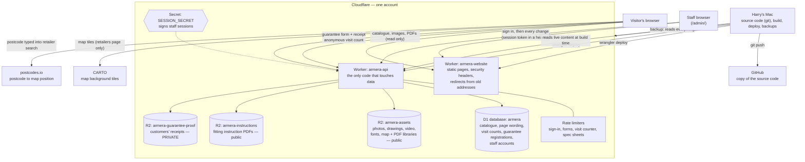

# How the ARMERA website is put together

Written for the pre-launch security sweep (checklist item PLAT-5), and kept
here rather than in `docs/` because `docs/` is rebuilt from scratch on every
deploy. Last checked against the running system on 16 November 2026.

Jargon, once: a **Worker** is a small program Cloudflare runs for you on its
own servers. **D1** is Cloudflare's database. **R2** is Cloudflare's file
storage. A **secret** is a password-like value a program needs but nobody
should read.

## The picture



## The layers, plainly

| Layer | What it is | Can it change data? |
|---|---|---|
| `armera-website` | The pages, as plain files. Built on Harry's Mac by `build.mjs`, uploaded by `deploy.sh`. | No. It has no access to the database or files at all. |
| `armera-api` | One program: `cloudflare/api/index.js` (+ `auth.js`, `spec.js`). | Yes — it is the only thing that can. |
| D1 `armera` | The database. | Only through `armera-api`. Not reachable from the internet. |
| R2 buckets | The files. | Only through `armera-api`. Not reachable from the internet directly. |

Because the pages and the data are separate programs, a flaw in a page cannot
reach the database — it can only ask the API, and the API decides.

## What the API will do, and for whom

**Anyone (no sign-in):**

| Address | Does | Guard |
|---|---|---|
| `GET /rest/v1/site_content` | Reads catalogue and page wording | Read only |
| `GET /assets/…`, `/instructions/…` | Serves public files | Read only; web-page file types are forced to download, never run |
| `POST /storage/v1/object/list/instructions` | Lists instruction PDFs | That one bucket only |
| `GET /spec/<cat>/<range>/<product>.pdf` | Builds a specification sheet | 20 a minute per address |
| `POST /track` | Records an anonymous page view | 60 a minute; fields checked and length-capped; no IP stored |
| `POST /guarantee` | Saves a guarantee registration | 6 a minute; every field checked and capped; hidden trap field for bots |
| `POST /swatch-request` | Saves a request for furniture colour swatches, then emails sales if email sending is switched on | 6 a minute; fields checked and capped; only colours that exist in the catalogue are accepted; hidden trap field |
| `POST /guarantee-proof` | Stores a receipt | 6 a minute; JPEG/PNG/WebP/HEIC/PDF only, checked against the file's real contents; 10 MB; the API picks the file name |
| `POST /auth/login`, `/auth/claim` | Sign in / set first password | 10 a minute per address; 8 wrong passwords locks that email for 15 minutes |
| `GET /health` | Says `{"ok":true}` | Nothing else revealed |

**Signed-in staff only** (everything under `/admin/…`, plus `/prefs`,
`/auth/me`, `/auth/change-password`): saving content, reading visit counts and
registrations, uploading and removing files, managing who can sign in.

A stranger cannot read customer data: registrations and receipts are only
served under `/admin/…`, which answers `401` without a valid session. This was
tested from outside on 16 November 2026.

## Signing in

- Passwords are never stored. A one-way scramble of each is (PBKDF2-SHA256,
  100,000 rounds — the most Cloudflare Workers allows).
- Signing in returns a session token, valid 14 days, kept by the browser and
  sent in a header. **No cookies are used**, which is what stops another
  website from making a signed-in browser act on its behalf (CSRF).
- Signing out, changing a password, or being switched off on the Team screen
  ends that person's sessions on the server immediately.
- Changing a password requires the current one.
- New staff get a one-time link (valid 7 days, works once). Only a fingerprint
  of the link is stored.
- **Not yet on:** two-step sign-in. The code to accept Cloudflare Access is in
  `auth.js` and switches on when `ACCESS_TEAM_DOMAIN` and `ACCESS_AUD` are set.
  That needs `armera.co.uk` to be on Cloudflare, so it is a launch-day job.

## Secrets: what exists and where

| Secret | Lives | In git? | In backups? | If lost |
|---|---|---|---|---|
| `SESSION_SECRET` | Cloudflare, on `armera-api` | No | No | Set a new one (`npx wrangler secret put SESSION_SECRET`). Everyone is signed out; nothing else is affected. So it does not need backing up. |
| `SUPABASE_ANON_KEY` | Cloudflare, on `armera-api` | It was, in old commits | No | **Unused. Delete it.** `npx wrangler secret delete SUPABASE_ANON_KEY` |
| Cloudflare sign-in | Harry's Mac (wrangler) and his Cloudflare account | No | No | Sign in again with `npx wrangler login` |
| Staff password scrambles | D1 `admin_users` | No | **Yes** — which is why backups stay out of the repo | Issue a new one-time link from the Team screen |

Not secrets, though they look like them: the CARTO map key and the API address
are in every page by design — a browser has to be able to read them.

## Personal data: what is held and where it flows

| Data | Whose | Where | Who can read it |
|---|---|---|---|
| Guarantee registration (name, email, address, installer, products) | Customers | D1 `guarantee_registrations` | Signed-in staff |
| Swatch request (name, postal address, email, optional phone and note) | Customers | D1 `swatch_requests` | Signed-in staff |
| Proof of purchase (photo or PDF) | Customers | R2 `armera-guarantee-proof` | Signed-in staff |
| Page views (page, device type, referring site, a random per-tab id) | Visitors, anonymously | D1 `page_views` | Signed-in staff |
| Staff email, name, password scramble | Staff | D1 `admin_users` | Signed-in staff (never the scramble) |
| Postcode typed into retailer search | Visitors | Sent to postcodes.io by the browser; never stored by ARMERA | — |

No cookies. No advertising or third-party analytics. Visitors can switch off
visit counting on the privacy page, and a browser's Do Not Track setting is
honoured.

## Things outside Cloudflare the site depends on

| Service | Used for | If it is down |
|---|---|---|
| CARTO | Map background on Find a retailer | Map is blank; the retailer list still works |
| postcodes.io | Turning a postcode into a map position | Search falls back to matching text |
| GitHub | A copy of the source code | No effect on the live site |

Leaflet (the map) and pdf.js (PDF previews) are served from ARMERA's own
storage, not from anyone else's servers.

## Publishing a change

```
./deploy.sh
```

Builds the pages from the live content, uploads them to Cloudflare, and
rebuilds `docs/`. The API is separate: `cd cloudflare/api && npx wrangler deploy`.

Cloudflare keeps every deployed version and can roll back to an earlier one
(`npx wrangler rollback` in the Worker's folder). It does not keep your source
code — git does.

### Launch day

```
INDEXABLE=1 SITE_URL=https://www.armera.co.uk ./deploy.sh
```

`INDEXABLE=1` removes the "search engines keep out" header. Until then every
page carries it, on purpose.

## Getting it back (backups)

```
node .tools/backup.mjs
```

| What | Where it goes | Holds personal data? |
|---|---|---|
| Catalogue and page wording | `backups/site_content-<date>.json` (in the repo) | No |
| The whole database | `../backups-private/<date>/d1.sql` (outside the repo) | **Yes** |
| Every stored file, all three buckets | `../backups-private/files/` (outside the repo) | **Yes** (receipts) |

The first run downloads everything (about 275 MB); later runs fetch only what
changed. Files removed from the site stay in the mirror.

**The backup lives on this Mac until you copy it somewhere else.** For it to
count as off-site, copy `backups-private/` to a second place (company
OneDrive/SharePoint or an encrypted external drive) after each run. Run it
weekly, and before any large edit.

### Restore test — carried out 16 November 2026

The database export was loaded into a brand-new scratch database and compared
with live: 13 content rows, 8 categories, 33 ranges, 157 products, 509
options, 998 page views, 2 registrations, 5 staff accounts — every count
identical, and content size and price totals identical. Three files from the
mirror were compared byte-for-byte with live. The scratch database was then
deleted.

### To restore for real

- **Something was changed or deleted in the last few days.** Cloudflare can
  wind the database back to any minute (Time Travel — 30 days on the paid
  Workers plan, 7 on the free one):
  `npx wrangler d1 time-travel restore armera --timestamp=<when>`
- **Worse than that.** Create a new database, load the export, point the API at it:
  ```
  npx wrangler d1 create armera-restored
  npx wrangler d1 execute armera-restored --remote --file ../backups-private/<date>/d1.sql
  # put the new database_id in cloudflare/api/wrangler.jsonc, then: npx wrangler deploy
  ```
- **A file.** Upload it again through the admin, or
  `npx wrangler r2 object put armera-assets/<path> --file <path> --remote`.

Restoring over live data is never automatic. Take a fresh backup first.
